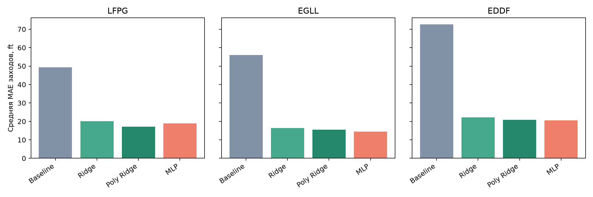
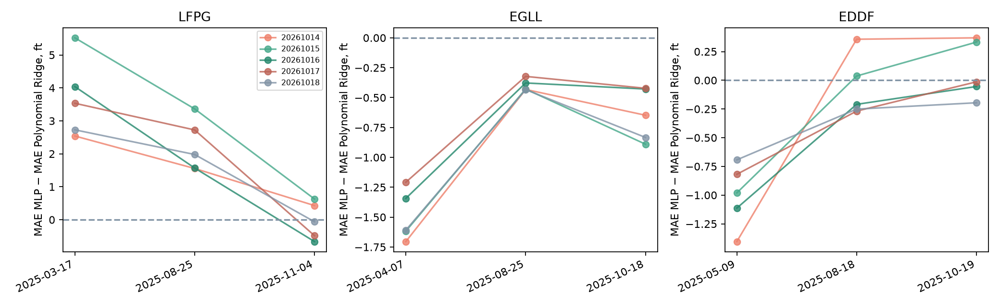

# Approach Risk 1.2 – итоговый результат

Исследование завершено 14.10.2026. Конвейер PostgreSQL → подготовка признаков → обучение поправки к физическому baseline → MLflow → анализ ошибок выполнен для LFPG, EGLL и EDDF. Обучаемая поправка уменьшает среднюю MAE относительно продолжения вертикальной скорости во всех трех выборках. Универсального преимущества PyTorch MLP над Polynomial Ridge не установлено

## Постановка и данные

Цель – последующая наблюдаемая высота через фактические 27–33 секунды. Baseline продолжает текущую вертикальную скорость; Ridge, Polynomial Ridge и MLP прогнозируют поправку к нему. Высота – барометрический прокси, а не радиовысота. Это регрессия высоты на заходе, без оценки go-around или эксплуатационной безопасности

Сезонные примеры и список дней перенесены из завершенного Approach Risk 1.1 без нового отбора. Для каждого аэропорта использованы 15 дней: 9 train, 3 validation и 3 test. Модели обучены отдельно для каждого аэропорта; перенос обученной модели между аэропортами не проверялся

| Аэропорт | Всего пар наблюдений | Всего заходов | Пар test | Заходов test |
| --- | ---: | ---: | ---: | ---: |
| LFPG | 15 931 | 553 | 1 924 | 55 |
| EGLL | 166 508 | 5 601 | 35 710 | 1 136 |
| EDDF | 96 714 | 2 634 | 19 337 | 540 |

Источник численности: [LFPG](reports/split_inventory.csv), [EGLL](reports/EGLL/split_inventory.csv), [EDDF](reports/EDDF/split_inventory.csv). Различие абсолютных MAE не доказывает различие сложности аэропортов: размеры и состав выборок неодинаковы

## Метод сравнения

MAE сначала усредняется по прогнозным парам внутри захода, затем по заходам. Длинный заход не получает больший вес. Обучение использует соответствующие веса; scaler и масштаб residual определяются только на train. Параметры и лучший epoch выбираются по validation. Исходная итоговая таблица относится к seed 20261014

Использованы девять признаков: высота, текущая вертикальная скорость, оценка скорости изменения высоты по истории, скорость, удаление до порога, боковое отклонение, ошибка курса, временной интервал истории и фактический горизонт. Последний известен ретроспективно, поэтому результат нельзя представлять как проверенный онлайн-прогноз строго на 30 секунд

MLP содержит два скрытых слоя с ReLU: LFPG 9 → 16 → 16 → 1, EGLL и EDDF 9 → 32 → 32 → 1. Обучение: взвешенный MSE поправки, Adam, learning rate 0.001, weight decay 0.0001, batch size 256, максимум 300 epochs, patience 30. Ширина выбрана по validation

## Основные результаты

| Модель | LFPG MAE, ft | EGLL MAE, ft | EDDF MAE, ft |
| --- | ---: | ---: | ---: |
| Constant vertical rate | 49.35 | 55.95 | 72.60 |
| Ridge | 20.03 | 16.34 | 22.23 |
| Polynomial Ridge | **17.16** | 15.45 | 20.87 |
| PyTorch MLP | 18.86 | **14.52** | **20.56** |

Числа: [общая таблица метрик](reports/three_airports_metrics.csv). Все модели внутри аэропорта оценены на одинаковом test

В LFPG Polynomial Ridge лучше MLP. В EGLL MLP уменьшает среднюю MAE каждого из трех тестовых дней. В EDDF исходный общий выигрыш MLP определяется майским днем; в августе и октябре Polynomial Ridge лучше

## Парные разницы и условная неопределенность

Отрицательная разница MAE MLP − MAE Polynomial Ridge означает преимущество MLP. Bootstrap выбирает борта с возвращением и сохраняет их заходы вместе: 10 000 повторов, seed 20261014, процентильные границы 2.5% и 97.5%

| Аэропорт | Средняя разница, ft | Условный 95% интервал, ft | Заходов с улучшением MLP |
| --- | ---: | ---: | ---: |
| LFPG | +1.70 | +0.83…+2.65 | 13 из 55 |
| EGLL | −0.93 | −1.13…−0.77 | 777 из 1 136 |
| EDDF | −0.31 | −0.56…−0.06 | 294 из 540 |

Источники: [LFPG](reports/paired_uncertainty.csv), [EGLL](reports/EGLL/paired_uncertainty.csv), [EDDF](reports/EDDF/paired_uncertainty.csv). Интервалы условны на трех наблюдаемых днях каждого аэропорта. Общая зависимость внутри дня, вариативность обучения и поправка на множественные сравнения в этих интервалах не учтены. Анализ выполнен после просмотра test

## Чувствительность MLP к seed

При фиксированных архитектурах, признаках и split выполнено 15 обучений: по пять seed 20261014–20261018 для каждого аэропорта. Лучший epoch каждого запуска выбран по validation; все обучения завершены перед новой оценкой test. Все запуски включены в отчеты, лучший seed по test не выбирался, исходные модели не заменены

| Аэропорт | MAE MLP, среднее ± SD, ft | Диапазон MAE, ft | Seed лучше Polynomial Ridge |
| --- | ---: | ---: | ---: |
| LFPG | 19.45 ± 0.77 | 18.86–20.77 | 0 из 5 |
| EGLL | 14.60 ± 0.15 | 14.47–14.79 | 5 из 5 |
| EDDF | 20.50 ± 0.10 | 20.37–20.62 | 5 из 5 |

SD – выборочное стандартное отклонение пяти запусков, без трактовки как доверительного интервала. Источники: [сводка](reports/seed_stability_summary.csv), [все результаты](reports/seed_stability_metrics.csv), [результаты по дням](reports/seed_stability_by_day.csv), [метод](docs/SEED_STABILITY.md)

Общий знак сравнения устойчив среди пяти seed во всех аэропортах. В EGLL MLP лучше на каждом дне при каждом seed. В EDDF майская разница отрицательна для всех seed, августовская и октябрьская меняют знак. В LFPG весенняя и летняя разницы положительны для всех seed, осенняя меняет знак. Устойчивость общего среднего не означает устойчивость каждого дня или перенос на новые условия

## Где возникают ошибки

Диагностика по высоте и удалению использует фиксированные описательные интервалы и равные веса заходов внутри интервала. Состав групп меняется; один заход может входить в несколько групп. В LFPG основной проигрыш MLP наблюдается на 2000–3000 ft и от 12 km. В EGLL средняя разница отрицательна во всех хорошо представленных интервалах; в EDDF знак зависит от интервала

Группы от 3000 ft содержат только 4 захода EGLL и 6 EDDF. Наблюдений ниже 500 ft и ближе 2 km нет. Границы не являются эксплуатационными ограничениями; интервалы неопределенности для этих разрезов не рассчитаны. [Ошибки по интервалам](reports/phase_errors.csv), [парные разницы](reports/phase_paired_errors.csv)

| Аэропорт | Модель | Медиана MAE захода, ft | P90, ft | P95, ft |
| --- | --- | ---: | ---: | ---: |
| LFPG | Polynomial Ridge | 16.83 | 23.85 | 28.70 |
| LFPG | PyTorch MLP | 17.67 | 28.47 | 30.04 |
| EGLL | Polynomial Ridge | 14.00 | 22.49 | 25.88 |
| EGLL | PyTorch MLP | 13.11 | 21.77 | 25.77 |
| EDDF | Polynomial Ridge | 18.73 | 32.47 | 38.76 |
| EDDF | PyTorch MLP | 18.74 | 32.16 | 37.85 |

Худшие примерно 5% заходов Polynomial Ridge и MLP дают около 10–12% суммы MAE заходов. Число заходов округляется вверх: 3 LFPG, 57 EGLL, 27 EDDF. В EGLL и EDDF средний выигрыш MLP сохраняется вне общего набора худших заходов, выбранного по Polynomial Ridge. Такой выбор группы зависит от модели сравнения. P95 LFPG особенно чувствителен к малой выборке. Хвост MAE заходов не является хвостом мгновенных ошибок высоты. [Квантили и концентрация](reports/error_tails.csv), [парное сравнение](reports/error_tails_paired.csv)

## Что подтверждено технически

PostgreSQL сохраняет фиксированный split и исходные значения. Загрузка транзакционная, повтор идентичного импорта не добавляет строк; конфликт измененных значений приводит к ошибке и откату. Извлечение через JOIN совпало с источником. GROUP BY и CTE реализуют равный вклад заходов

В отдельном окружении Python 3.12.14 из lock-файла проверены 131 версия пакета, 45 исходных Parquet по хешам, PostgreSQL, восстановление девяти исходных моделей и 15 дополнительных MLP. Прошли 21 тест и выполнение обоих ноутбуков. Метрики, архивные модели и исходники обучения 15 повторных MLflow runs сверены; 12 исходных runs проверены отдельно. [Финальное ревью](docs/FINAL_REVIEW.md), [машиночитаемая проверка](reports/reproducibility.json)

Классические артефакты первого запуска LFPG в 1.2 отсутствовали: сохраненные pipeline импортированы из 1.1 с явным происхождением, совпадающими параметрами, validation и агрегатными test-метриками. Это не доказывает идентичность каждой точки первого запуска 1.2. Остальные исходные модели и дополнительные MLP сохранены при обучении в 1.2

## Границы результата и продолжение

Выводы относятся к выбранным погожим дням и полосам. Сезон представлен одним тестовым днем; борта могут повторяться между split. Высота является прокси, исторические NOTAM и эксплуатационная применимость не подтверждены. Проверка пяти seed фиксирует данные и не устраняет неопределенность новых дней

Воспроизведение требует имеющихся локальных данных 1.1, моделей, MLflow и PostgreSQL. Получение архивов с нуля, перенос всего окружения на новый компьютер и повтор полного обучения на нем не проверены. Данные, модели, секреты и чекпоинты исключены из Git

Следующий научный этап – отдельный прогноз на заранее заданные 30 секунд с признаками, доступными на момент прогноза, и заранее определенными новыми днями оценки. Текущие test-результаты не используются для нового подбора параметров

Подробный ход исследования: [LFPG](notebooks/01_lfpg_pipeline.ipynb) и [три аэропорта](notebooks/02_three_airports.ipynb)
