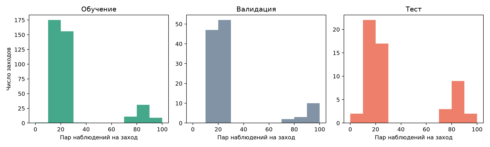

# Агрегация ошибки по заходам

Один заход содержит несколько пар наблюдений. Основная единица оценки исследования – заход. Для абсолютной ошибки a_ij в паре j захода i сначала вычисляется MAE_i = sum(a_ij) / n_i. Итоговая метрика равна sum(MAE_i) / N, где N – число заходов

Средняя ошибка по всем строкам равна sum(n_i × MAE_i) / sum(n_i). В ней вклад захода пропорционален числу пар. Равный вес заходов устраняет эту зависимость, но не выравнивает вклад дней или сезонов

## SQL-расчет

```sql
WITH event_errors AS (
    SELECT e.airport, d.split, e.event_id,
           count(*) AS pairs,
           avg(abs(e.target_height_ft - e.baseline_ft)) AS event_mae_ft
    FROM altitude.examples e
    JOIN altitude.study_days d USING (airport, day)
    WHERE e.airport = 'LFPG'
    GROUP BY e.airport, d.split, e.event_id
)
SELECT airport, split, avg(event_mae_ft) AS event_macro_mae_ft,
       sum(pairs * event_mae_ft) / sum(pairs) AS row_mae_ft
FROM event_errors
GROUP BY airport, split;
```

Внутренний GROUP BY сворачивает пары в одну запись на заход. CTE event_errors именует промежуточный результат запроса. Внешний GROUP BY вычисляет итог по каждой выборке. CTE не создает постоянную таблицу

## Результаты физического baseline LFPG

| Выборка | Заходов | Пар | MAE по заходам, ft | MAE по строкам, ft | Пар на заход: минимум / медиана / максимум |
| --- | ---: | ---: | ---: | ---: | --- |
| Train | 384 | 10 715 | 57.73 | 55.59 | 7 / 20 / 96 |
| Validation | 114 | 3 292 | 54.29 | 50.22 | 13 / 20 / 98 |
| Test | 55 | 1 924 | 49.35 | 51.58 | 8 / 21 / 97 |

SQL-результаты независимо сверены с Python по извлеченным данным. На тесте MAE по строкам выше на 2.23 ft, около 4.51% относительно MAE по заходам. В train и validation направление разницы обратное. Следовательно, равный вес заходов задает способ оценки и не гарантирует уменьшения метрики



Количество пар не является прямым измерением длительности захода: оно зависит также от частоты наблюдений, пропусков и пригодности пар. Поэтому график описывает объем примеров на заход, а не распределение продолжительности полетов

Сравнение относится к физическому baseline на фиксированном наборе. Оно не меняет основную метрику, split или параметры моделей. Зависимость наблюдений внутри захода и повторение бортов между днями сохраняются; для оценки неопределенности нельзя считать пары независимыми испытаниями

```powershell
.\.venv\Scripts\python.exe scripts/event_mae_report.py
```
