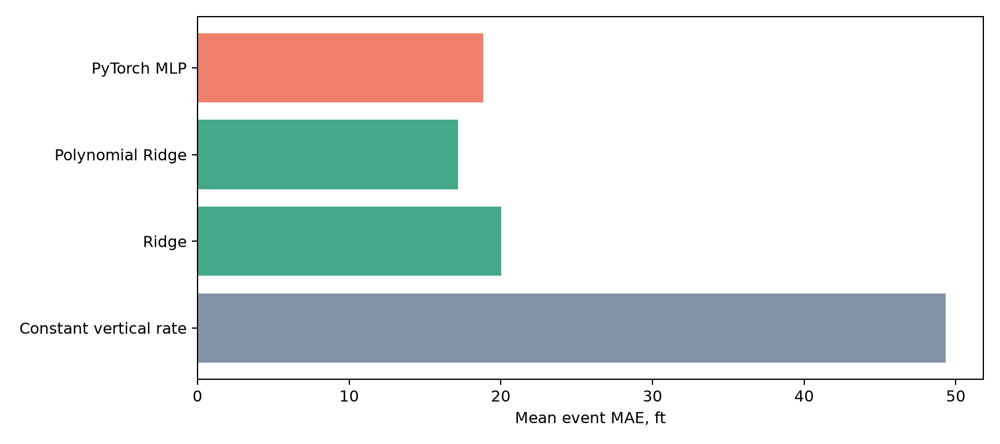
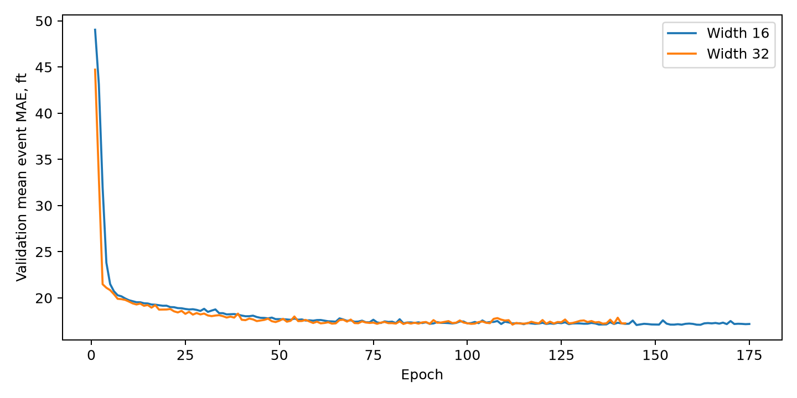
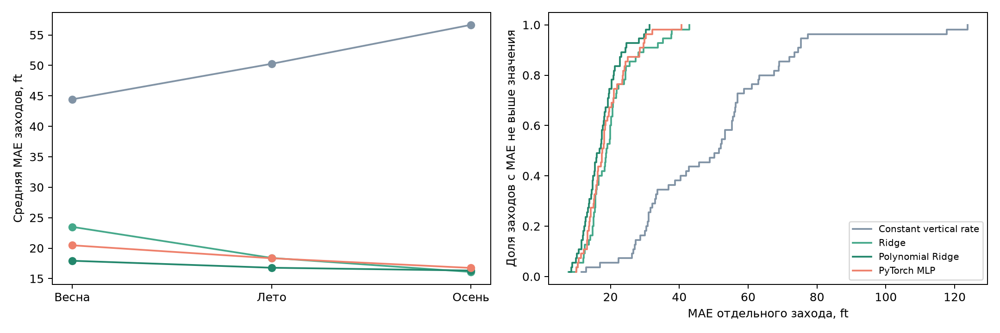

# LFPG – первый сквозной запуск

14.10.2026. Данные: 15 931 пара, 553 захода; итоговый test: 55 заходов. Выборка и split перенесены из сезонного исследования 1.1. Данные загружены в PostgreSQL 17.11 и извлечены через JOIN с таблицей дней. Повторная загрузка добавила ноль строк, сверка всех значений после извлечения прошла

| Модель | Средняя MAE заходов, ft | Корень из средней MSE заходов, ft |
| --- | ---: | ---: |
| Постоянная вертикальная скорость | 49.348959 | 67.995818 |
| Ridge | 20.033286 | 25.796078 |
| Polynomial Ridge | 17.163963 | 22.244615 |
| PyTorch MLP | 18.862559 | 24.466738 |

MLP улучшила baseline, но уступила Polynomial Ridge. Гиперпараметры и early stopping выбирались по validation. Параметры моделей зафиксированы до оценки test. Результаты не служат основанием для нового подбора по test

Четыре MLflow runs содержат параметры, метрики, хеш извлеченной выборки, seed и SHA кода 69fc0ad. Все вычисления выполнялись на CPU. Для PyTorch сохранены веса, параметры scaler и история validation

Ограничения: одна полоса, отобранные погожие дни, три тестовых дня, повторение бортов между split, ретроспективно известный фактический горизонт как признак. Это регрессия высоты, без оценки go-around и без эксплуатационной валидации

## Анализ ошибок

Без переобучения использованы сохраненная MLP 1.2 и pooled-модели 1.1. Параметры классических моделей и агрегатные MAE/RMSE совпали с запуском 1.2. Исходные классические артефакты первого запуска 1.2 не сохранены; совпадение агрегатов не доказывает совпадения каждой прогнозной точки. Происхождение и хеши записаны в error_analysis_provenance.json

Polynomial Ridge улучшила baseline на 52 из 55 тестовых заходов, MLP на 51. MLP лучше Polynomial Ridge на 13 заходах и хуже на 42, средняя разница MAE +1.70 ft. Осенью Ridge имеет меньшую среднюю MAE, чем обе эти модели

Летом средняя ошибка со знаком положительна для Polynomial Ridge (+9.22 ft) и MLP (+10.62 ft), весной и осенью отрицательна. Знак определен как прогноз минус наблюдение. Это описательный анализ: на сезон приходится один тестовый день, влияние сезона не отделено от конкретного дня и состава заходов. Статистическая значимость не проверена

